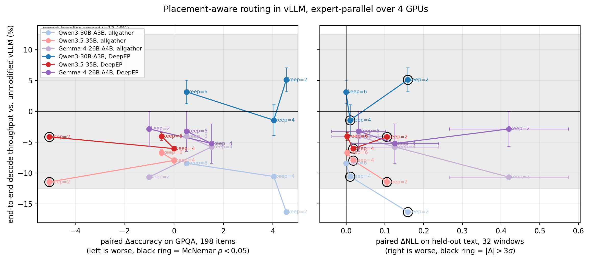

# Placement-Aware MoE Router

A vLLM plugin that re-routes the bottom of each token's expert selection onto the GPUs the
token is already being sent to, and the experiments that measure what that costs and buys on
four MoE families.

A token routed to top-8 of a few hundred experts in an expert-parallel deployment usually has
to be sent to *every* GPU, because eight experts drawn from that many rarely share a device.
The all-to-all dispatch costs one copy of the token per destination GPU. Published ablations
find the selection is not uniformly important - the top few experts carry the result and the
bottom ones can be substituted with little accuracy loss - so the bottom slots are free
parameters, and there is an obvious thing to spend them on:

> Keep the top `keep` experts by router score. The *allowed set* is every expert living on a
> GPU that those `keep` already require. Fill the remaining `top_k - keep` slots from the
> allowed set, by score. Per-token GPU fan-out drops to `|GPUs of the top keep|`; the number of
> experts per token, and so the expert GEMM work, is unchanged.

The saving is purely communication, which is why it has to be measured rather than counted.



## Using it

`PAR_KEEP` is the only knob. Unset, the plugin patches nothing and the image is stock vLLM -
which is also the arm every claim here is compared against.

```bash
docker build -t par-vllm:v0.31.0 -f docker/Dockerfile .
docker run --gpus all -e PAR_KEEP=2 par-vllm:v0.31.0 \
  --model Qwen/Qwen3-30B-A3B --tensor-parallel-size 4 --enable-expert-parallel
```

```bash
helm install par helm/par --set keep=2 --set gpus=4 --set model=Qwen/Qwen3-30B-A3B
```

Or into an existing environment, against any vLLM 0.31 install:

```bash
pip install --no-deps -e .   # registers the `vllm.general_plugins` entry point
PAR_KEEP=2 vllm serve <model> --tensor-parallel-size 4 --enable-expert-parallel
```

## How it hooks in

vLLM v0.31 routes every fused-MoE layer through `BaseRouter._select_experts`, which validates
EPLB state, delegates to a subclass `_compute_routing`, maps logical expert ids to physical and
fixes the index dtype. `src/par/plugin.py` wraps that one method: the model's own router
computes its own top-k, then the Triton kernel in `src/par/kernel.py` rewrites the bottom
`k - keep` ids and the gate weights are regathered at the new indices. The dispatch, the
combine, the expert GEMMs and every other routing variant are untouched, which is the only
reason this is safe to drop into a stock image.

Expert-to-rank needs no map tensor: vLLM shards experts in contiguous blocks, so rank is
`expert * ep_size // num_experts`, computed in the kernel.

The wrapper **passes the selection through unchanged, with one warning**, wherever the rule's
premise does not hold: EPLB replication (expert id no longer implies a rank), grouped top-k or
score-correction bias or zero-expert routing (the ranking is not the gate logits, so "the top
`keep` by logit" is not the head the router chose), a rank count of 1 (no all-to-all to
shrink), and a non-divisible or too-small expert block (no substitute is guaranteed to exist).
A routing rule that silently applied where its premise fails would be measured as free and
serve garbage.

## The measurements

Two independent ones, because they fail in different ways.

**In vLLM - `experiments/vllm_run.py`, `experiments/compare.py`.** A stock engine, four GPUs,
expert-parallel, nothing swapped but the router. One process per arm, since `PAR_KEEP` is read
when the engine loads. Throughput is wall clock for a fixed decode workload with `ignore_eos`
and a fixed token batch, so no arm can look fast by doing less; accuracy is GPQA scored by
option likelihood, paired per item. The honest resolution of the y axis is `base2` - the stock
engine loaded and measured a second time - and the figure draws that band.

Three families, not four: vLLM 0.31 has no native Hunyuan-MoE implementation and serves
`HunYuanMoEV1ForCausalLM` through its Transformers backend, which executes the checkpoint's own
modelling file - and that file still selects attention from a hard-coded class dict, so it
rejects the `vllm` attention implementation the backend installs. Hunyuan therefore appears in
the offline sweep only. Making it load would mean rewriting someone's modelling code and then
measuring that, which is not the same experiment.

**Offline, isolating the all-to-all - `experiments/{accuracy,bench,latency}.py`.** The vLLM
number is end-to-end, so a real saving in the dispatch shows up diluted by everything else in
a forward pass. The offline sweep replays recorded routing through one hand-built
expert-parallel layer over NCCL `all_to_all_single` and times the collective itself across a
batch sweep, which is the only way to see the mechanism. It is a model of serving, not serving;
the pair is the point.

## What keeps it honest

* **A no-op arm.** `keep = top_k` makes the allowed set the one the baseline already visits, so
  it must reproduce the baseline exactly. A non-zero delta is a hard stop, not a warning.
* **A repeat baseline.** `base2` is the stock arm run again in its own process. Every number
  here is wall clock on a shared cluster; a gap smaller than what one configuration reports
  twice is not a speedup.
* **A random control** (offline) making the same number of substitutions with no placement
  benefit, which separates "the bottom experts do not matter" from "our replacement is good".
* **Discordant counts** next to every McNemar p. Below a handful of discordant pairs the honest
  reading is "not resolved", not "no difference".
* **A kernel self-check** that runs on the GPU before anything is measured: the Triton path
  against the torch reference on a shuffled selection, and the mean fan-out against the exact
  hypergeometric closed form.
* **Two things that bias against the offline result.** No compute is overlapped with the
  collectives, and the local experts run as a capacity-padded batched GEMM, so re-routing -
  which concentrates tokens onto already-hot GPUs - is charged padding the baseline does not
  pay. Both inflate compute, understating the communication fraction this shrinks. The padding
  factor and the collective-only time are reported per arm.

## Reproducing

```bash
# the real measurement: one vLLM engine per arm
MODEL=/models/qwen3-30b-a3b TAG=q30rh ARMS=base,base2,6,4,2 experiments/run.sh
python experiments/compare.py

# the offline sweep: needs a cached token stream at $STREAMS/$STREAM.npy
MODEL=/models/qwen3-30b-a3b TAG=q30rh experiments/run.sh
python experiments/plot.py
```

On OpenShift, one Job per model (`ARMS` switches a job to the vLLM path):

```bash
experiments/k8s/launch.sh NAME=q30 TAG=q30rh MODEL=/models/bf16      ARMS=base,base2,6,4,2
experiments/k8s/launch.sh NAME=q35 TAG=q35   MODEL=/models/q35_bf16  ARMS=base,base2,6,4,2
experiments/k8s/launch.sh NAME=hy  TAG=hy13b MODEL=/models/hy_bf16   ARMS=base,base2,6,4,2
experiments/k8s/launch.sh NAME=gm  TAG=gm26b MODEL=/models/gm_bf16   ARMS=base,base2,6,4,2
```

## Files

| | |
| --- | --- |
| `src/par/kernel.py` | the rule: Triton kernel, torch reference, fan-out metric, self-check |
| `src/par/plugin.py` | the vLLM hook and the guards that decline to apply it |
| `docker/`, `helm/` | the stock serving image with the router swapped, and a chart for it |
| `experiments/vllm_run.py` | one arm in real vLLM: GPQA and decode throughput |
| `experiments/compare.py` | the vLLM figure and the paired statistics |
| `experiments/accuracy.py` | offline `delta-NLL` per arm, plus the routing traces |
| `experiments/bench.py` | offline GPQA per arm, McNemar's exact paired test |
| `experiments/latency.py` | offline expert-parallel MoE layer time under those traces |
| `experiments/plot.py` | the offline figure |
| `experiments/hunyuan_capacity.py` | Hunyuan's gate drops tokens past a capacity equal to the mean load; this raises it to the true maximum |
| `experiments/k8s/` | one Job per model |
