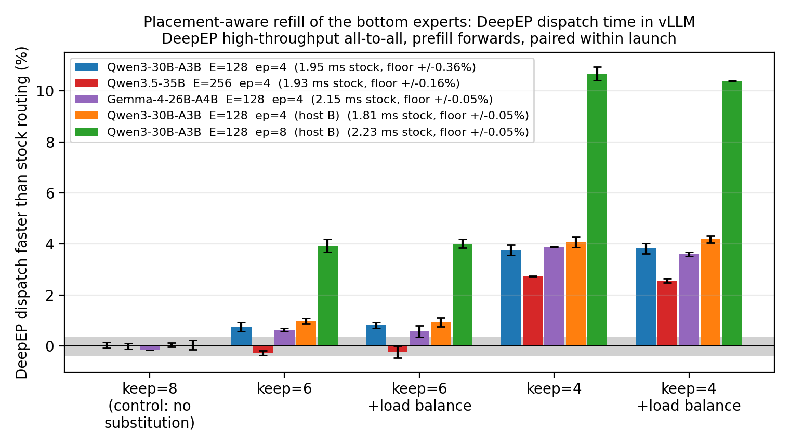
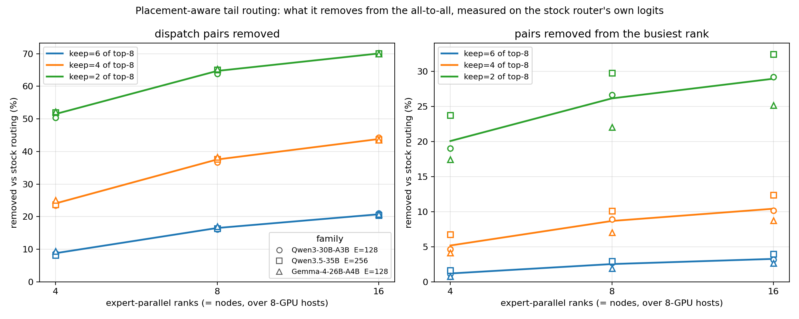

# Placement-Aware MoE Router

A vLLM plugin that re-routes the bottom of each token's expert selection onto the GPUs the
token is already being sent to, and the experiments that measure what that costs and buys on
four MoE families - three of them inside vLLM, the fourth offline only.

A token routed to top-8 of a few hundred experts in an expert-parallel deployment usually has
to be sent to *every* GPU, because eight experts drawn from that many rarely share a device.
The all-to-all dispatch costs one copy of the token per destination GPU. The selection is not
uniformly important - the top few experts carry the result and the bottom ones can be
substituted with little accuracy loss (arXiv 2412.00099, which also does the restricted-set
reroute this rule reuses; see [the literature](#where-this-sits-in-the-literature)) - so the
bottom slots are free parameters, and there is an obvious thing to spend them on:

> Keep the top `keep` experts by router score. The *allowed set* is every expert living on a
> GPU that those `keep` already require. Fill the remaining `top_k - keep` slots from the
> allowed set, by score. Per-token GPU fan-out drops to `|GPUs of the top keep|`; the number of
> experts per token, and so the expert GEMM work, is unchanged.

The saving is purely communication, which is why it has to be measured rather than counted.
On a real four-rank all-to-all at 16384 tokens per step it is **+20.9% to +28.4% on the
dispatch** at `keep=4` and up to **+91.9%** at `keep=2`, against a control envelope of
+/-2.1%.


## Using it

`PLACEMENT_KEEP` is the knob. Unset, the plugin patches nothing and the image is stock vLLM - which
is also the arm every claim here is compared against. `PLACEMENT_LOAD_PENALTY` is the second one, defaulting
to `0`: it charges each substituted slot that much per expert slot already placed on its
destination rank, which flattens the load the plain rule piles onto the busiest rank at no cost
in volume.

**Start at `PLACEMENT_KEEP=6 PLACEMENT_LOAD_PENALTY=1`.** That is the arm where every measured
quantity moves the right way at once: `keep=6` is the deepest substitution this repo cannot
distinguish from stock on paired NLL ([what the rule costs in
quality](#what-the-rule-costs-in-quality)), and at `load_penalty=1` it removes 9-21% of the
dispatch pairs and 1-3% of what the busiest rank receives while spreading expert slots
*flatter* than stock routing does ([the same measurement on a trained
router](#the-same-measurement-on-a-trained-router-inside-the-engine)). Lower `keep` buys
roughly twice the volume at `keep=4` and three times at `keep=2`, and both are resolved
quality regressions on the Qwen families - worth it only if the all-to-all is the measured
bottleneck.

```bash
docker build -t placement-router-vllm:v0.31.0 -f docker/Dockerfile .
docker run --gpus all -e PLACEMENT_KEEP=6 -e PLACEMENT_LOAD_PENALTY=1 placement-router-vllm:v0.31.0 \
  --model Qwen/Qwen3-30B-A3B --tensor-parallel-size 4 --enable-expert-parallel
```

```bash
helm install placement-router helm/placement-router --set keep=6 --set loadPenalty=1 --set gpus=4 --set model=Qwen/Qwen3-30B-A3B
```

Or into an existing environment, against any vLLM 0.31 install:

```bash
pip install --no-deps -e .   # registers the `vllm.general_plugins` entry point
PLACEMENT_KEEP=6 PLACEMENT_LOAD_PENALTY=1 vllm serve <model> --tensor-parallel-size 4 --enable-expert-parallel
```

## How it hooks in

vLLM v0.31 routes every fused-MoE layer through `BaseRouter._select_experts`, which validates
EPLB state, delegates to a subclass `_compute_routing`, maps logical expert ids to physical and
fixes the index dtype. `src/placement_router/vendor/fused_topk_router.py` is that subclass vendored
verbatim from v0.31.0 with two imports and four lines changed: the Triton kernel in
`src/placement_router/kernel.py` *replaces* the fused top-k rather than running after it, so an arm spends
the one launch per MoE layer stock vLLM also spends. Gemma routes through `CustomRoutingRouter`
instead, so `src/placement_router/plugin.py` wraps that method and substitutes the kernel for the model's
own routing function, folding in its per-expert scale. The dispatch, the combine, the expert
GEMMs and every other routing variant are untouched, which is the only reason this is safe to
drop into a stock image.

Expert-to-rank needs no map tensor: vLLM shards experts in contiguous blocks, so rank is
`expert * ep_size // num_experts`, computed in the kernel.

The router **passes the selection through unchanged, with one warning**, wherever the rule's
premise does not hold. `_unsupported` in `src/placement_router/plugin.py` is the whole list: a router class
or custom routing function that does not rank by gate logits alone (grouped top-k, score
correction, zero-expert routing - "the top `keep` by logit" would not be the head the router
chose), a non-softmax `scoring_func` or routing without renormalization (the kernel's softmax
is scoped to the selection), EPLB replication (expert id no longer implies a rank), `keep >
top_k`, a logit width that disagrees with the expert count, a rank count of 1 (no all-to-all
to shrink), a non-divisible or too-small expert block (no substitute is guaranteed to exist),
and `ep_size > 32` (the kernel tracks the head's ranks in one int32 lane). `keep == top_k` is
allowed through on purpose: that arm is the control. A routing rule that silently applied
where its premise fails would be measured as free and serve garbage.

## What it measures out at

**The rule is faster where dispatch is a dispatch.** `experiments/latency.py` runs the real
thing - a four-rank expert-parallel MoE layer on H100s, dispatch and combine over NCCL
`all_to_all_single`, with expert capacity fixed per batch from `B, k, E` alone so the expert
GEMM is bit-identical in every arm and the only thing left between two arms is the payload. At
16384 tokens per step, on all four families:

| model | keep | mean fan-out | dispatch bytes | **dispatch** | layer | random control |
|---|---|---|---|---|---|---|
| Qwen3-30B-A3B  E=128 | 6 of 8 | 3.63 -> 3.30 | -8.9% | **+7.2%** | +2.6% | +1.2% |
| Qwen3-30B-A3B  E=128 | 4 of 8 | 3.63 -> 2.74 | -24.6% | **+23.6%** | +4.3% | +1.5% |
| Qwen3-30B-A3B  E=128 | 2 of 8 | 3.63 -> 1.75 | -51.9% | **+68.9%** | +9.1% | +2.0% |
| Qwen3.5-35B  E=256 | 6 of 8 | 3.62 -> 3.32 | -8.5% | **+7.0%** | +1.6% | -0.6% |
| Qwen3.5-35B  E=256 | 4 of 8 | 3.62 -> 2.76 | -23.8% | **+22.4%** | +3.8% | -0.0% |
| Qwen3.5-35B  E=256 | 2 of 8 | 3.62 -> 1.76 | -51.3% | **+70.5%** | +8.0% | +0.8% |
| Gemma-4-26B-A4B  E=128 | 6 of 8 | 3.64 -> 3.33 | -8.5% | **+6.2%** | +2.3% | +0.3% |
| Gemma-4-26B-A4B  E=128 | 4 of 8 | 3.64 -> 2.76 | -24.2% | **+20.9%** | +5.3% | +1.7% |
| Gemma-4-26B-A4B  E=128 | 2 of 8 | 3.64 -> 1.75 | -51.9% | **+69.9%** | +8.2% | +2.1% |
| Hunyuan-A13B  E=64 | 6 of 8 | 3.65 -> 3.34 | -8.6% | **+8.6%** | +0.9% | +0.2% |
| Hunyuan-A13B  E=64 | 4 of 8 | 3.65 -> 2.77 | -24.2% | **+28.4%** | -0.8% | +0.1% |
| Hunyuan-A13B  E=64 | 2 of 8 | 3.65 -> 1.76 | -51.8% | **+91.9%** | -3.5% | +0.6% |

`runs/speedup.png` is that table as a figure, and its right panel is the mechanism: measured
speedup against the speedup the byte ratio alone predicts, twelve points on one line just
under the diagonal.

Three controls bound what any of that has to clear, and all of them land inside **+/-2.1%**:
`noop` (routing identical to the baseline), `baseline2` (the same configuration timed a second
time), and `random_k`, which makes the same number of substitutions at random and therefore
cuts no fan-out (3.623 against the baseline's 3.628). The smallest `keep=4` dispatch gain is
ten times that envelope, and `experiments/speedup.py` asserts the margin is at least 5x before
it will write the figure. `random_k` is the control that carries the argument: substituting
bottom experts buys nothing on its own, so what the table measures is placement.

The saving is a payload saving, so it arrives only once the collective is bandwidth-bound -
`T = L + V/B_eff`, and the rule moves `V`, never `L`. The same arm across the batch sweep goes
**+5.7% -> +14.3% -> +23.6%** (Qwen3-30B, `keep=4`, at 1024 -> 4096 -> 16384 tokens per step),
which is that crossover, and is why the figure draws all three batches instead of picking the
flattering one. It is also why the measured speedup sits below the byte ratio's prediction at
`keep=2`: the launch term is the part the rule cannot touch.

How far past the dispatch it reaches is set by what fraction of the layer the dispatch is - 33%
for the Qwen families, 32% for Gemma, and 16% for Hunyuan, whose `H=4096` over `E=64` buys a
much heavier expert GEMM. So on the first three the same dispatch win is +3.8% to +5.3% of the
whole layer at `keep=4`.

**The plugin is free to run**: `keep = top_k` asks for no substitution, and across two engine
loads it comes out at +0.22% throughput. **The rule costs real accuracy** below `keep=6`,
resolved at 3 sigma on both Qwen families.

End-to-end serve throughput is a different measurement condition, because vLLM 0.31's default
dispatch cannot express a fan-out saving at all - see
[the backend where the saving exists](#the-backend-where-the-saving-exists). On that backend at
a real token budget (`q30pf`, 32 requests of 4096 prompt tokens at
`--max-num-batched-tokens 8192`, ep=4 on one host, five base launches over two sweeps) the arms
come out monotone in what the rule costs rather than in what it saves: `keep=8` **+0.33%**,
`keep=6` **-0.49%**, `keep=4` **-3.16%**, `keep=2` **-5.43%**, against a base spread of 0.64%
and 0.22% across the two sweeps. An earlier version of that run chunked its prompts into
256-token steps - under data parallelism vLLM caps the scheduler at 256 tokens per step rather
than the usual 2048 (`DEFAULT_MAX_NUM_BATCHED_TOKENS_FOR_BATCHED_DP`, applied in `arg_utils.py`
whenever the flag is unset) - which was a real defect in the instrument; `BATCH_TOK` now passes
the budget explicitly and every artefact records it.

An earlier set of throughput numbers was withdrawn, and the fix for it is why the control arm
above is clean. vLLM pads a batch for cudagraph and data-parallel capture and marks the padding
by forcing those tokens' expert ids to `-1`, so the dispatch and the experts drop them
(`VLLM_MOE_SKIP_PADDING`, on by default since 0.31). A `-1` is not a selection, and the first
kernel treated it as one: its `argmax` ran over an all-`-inf` block, fewer than `top_k` output
slots got written, and the row came out holding whatever `torch.empty` had left there. Real
expert ids, for tokens the unmodified engine never dispatches - so the baseline arms skipped
that padding and the rule's arms paid full dispatch and expert GEMM for it, which at decode
batch sizes is most of a measurement. It also explains the one failure that was not a quiet
bias: a `-1` reaching Gemma's index scatter asserted out of bounds mid-run
(`ScatterGatherKernel.cu:203`).

The kernel now declines any row that is not `top_k` distinct in-range experts and returns it
byte-for-byte, sentinel included; `src/placement_router/kernel.py` asserts that on GPU before any arm runs.
That moved the no-op control from about -9% to +0.22%. The quality numbers were never affected
- vLLM's fused MoE imposes no expert capacity, so a padded token routed by mistake costs time
and takes nothing from a real token's output.

Which dispatch the engine is configured with decides whether the saving above is reachable at
all. vLLM 0.31 defaults to `allgather_reducescatter`, which gathers every token onto every
rank: the volume it moves does not depend on per-token GPU fan-out, so there is nothing there
for this rule to shrink and its cost is the whole of its effect. That is a property of the
backend and not of the rule. DeepEP and `nixl_ep` dispatch per destination rank, deduplicating
exactly the `(token, rank)` pairs `latency.py` times, which is the regime the table measures.

### Timed inside a running engine

`latency.py` above is a standalone MoE layer, so every term in it is under the measurement's
control. The engine is not: the same rule has to pay for itself inside `vllm serve` with a
trained router, real token shapes, and no expert capacity. `experiments/moetime.py` rides along
on every serve launch, records a CUDA event pair around `MoERunner._forward_impl` and a second
pair around DeepEP's dispatch and the wait on its completion event, and reduces each to a
median per power-of-two token-count bucket. Every arm is divided by the base arms of *its own
launch*, because an unmodified engine loaded twice measures a few tenths of a percent against
itself; the grey band in the figures is that floor, measured rather than assumed. `keep=8` is
the zero-substitution control: the kernel runs and selects nothing different.



<!-- disptime -->
| model | stock ms / deepep dispatch | tokens / forward | floor | keep=8 (control: no substitution) | keep=6 | keep=6 +load balance | keep=4 | keep=4 +load balance |
|---|---|---|---|---|---|---|---|---|
| Qwen3-30B-A3B  E=128  ep=4 | 1.95 | 16384 | +/-0.36% | **+0.0%** x4 | **+0.8%** x4 | **+0.8%** x4 | **+3.8%** x3 | **+3.8%** x2 |
| Qwen3.5-35B  E=256  ep=4 | 1.93 | 16384 | +/-0.16% | **-0.0%** x3 | **-0.3%** x2 | **-0.2%** x3 | **+2.7%** x2 | **+2.6%** x3 |
| Gemma-4-26B-A4B  E=128  ep=4 | 2.15 | 16384 | +/-0.05% | **-0.2%** x1 | **+0.6%** x3 | **+0.6%** x2 | **+3.9%** x1 | **+3.6%** x2 |
| Qwen3-30B-A3B  E=128  ep=4  (host B) | 1.81 | 16384 | +/-0.05% | **+0.0%** x3 | **+1.0%** x3 | **+0.9%** x3 | **+4.1%** x3 | **+4.2%** x3 |
| Qwen3-30B-A3B  E=128  ep=8  (host B) | 2.23 | 16384 | +/-0.05% | **+0.0%** x3 | **+3.9%** x3 | **+4.0%** x5 | **+10.7%** x2 | **+10.4%** x2 |
<!-- /disptime -->

The numbers are the 16384-token prefill bucket, `x`n is how many independent launches each cell
averages, and positive is faster. The floor is per row, because a cell is only ever divided by
launches of its own tag: it is that row's widest base-against-base spread, halved. Four things
make this the rule rather than the instrument. The full substitution budget, `keep=4`, is faster
on every row and every family, from +2.6% to +10.7%. The zero-substitution control is not (-0.2%
to +0.0%), so the kernel's own cost is not what is being measured. The gain is monotone in the
substitution budget, within every row. And the last two rows are the same model on the same host
type at two world sizes, so the `ep` step can be read without crossing clusters: 0.9% becomes
4.0% at `keep=6`, 4.2% becomes 10.4% at `keep=4`. That is what a fan-out saving has to do, since
a wider world gives a fixed `keep` more distinct ranks to avoid visiting.

Timing dispatch separately is not a convenience. The whole-layer clock nets the byte saving
against the expert GEMM, and that GEMM is grouped: restricting the allowed expert set skews the
group sizes, and a grouped GEMM is bound by its largest group. In the engine nothing caps an
expert's token count, unlike `latency.py`'s fixed capacity, so the skew is free to grow. That is
also what the load-balance term is for - adding the max-rank-load penalty to the same objective
(`PLACEMENT_LOAD_PENALTY=1`) keeps the dispatch saving and pays the skew back:

<!-- moetime -->
| model | stock ms / moe layer | tokens / forward | floor | keep=8 (control: no substitution) | keep=6 | keep=6 +load balance | keep=4 | keep=4 +load balance |
|---|---|---|---|---|---|---|---|---|
| Qwen3-30B-A3B  E=128  ep=4 | 8.08 | 16384 | +/-0.20% | **-0.6%** x6 | **-2.1%** x6 | **+1.9%** x4 | **-5.2%** x5 | **-1.6%** x3 |
| Qwen3.5-35B  E=256  ep=4 | 7.00 | 16384 | +/-0.22% | **-0.4%** x5 | **-1.8%** x4 | **+0.5%** x3 | **-2.0%** x4 | **-1.1%** x3 |
| Gemma-4-26B-A4B  E=128  ep=4 | 9.72 | 16384 | +/-0.14% | **-0.2%** x2 | **-1.9%** x4 | **+3.2%** x2 | **-5.2%** x2 | **-0.2%** x2 |
| Qwen3-30B-A3B  E=128  ep=4  (host B) | 7.56 | 16384 | +/-0.08% | **-0.6%** x3 | **-2.3%** x3 | **+2.0%** x3 | **-5.4%** x3 | **-1.9%** x3 |
| Qwen3-30B-A3B  E=128  ep=8  (host B) | 11.17 | 16384 | +/-0.52% | **-0.1%** x4 | **-3.1%** x3 | **+0.5%** x6 | **-6.0%** x2 | **-1.7%** x3 |
<!-- /moetime -->

`keep=6` with the load-balance term is the only arm that clears the floor on the whole-layer
clock, and it clears it on all five rows - +1.9%, +0.5%, +3.2%, +2.0%, +0.5%, against floors of
0.08% to 0.52% - while the dispatch saving underneath is 10x to 200x its own floor at every
budget. That is the split,
and it is why both figures are here: `runs/disptime.png` measures the term the rule acts on,
and `runs/moetime.png` measures what reaches the layer after the grouped GEMM has had its say.
`keep=6 load_penalty=1` is therefore the arm to deploy, and it is the one the offline
[`ep` sweep](#the-same-measurement-on-a-trained-router-inside-the-engine) already singled out
on load grounds alone.

### How much there is to shrink, before anything is measured

Dispatch volume is per-token GPU fan-out, and for uniform logits that is analytic: a rank
holds `E/G` of the `E` experts, so a top-k drawn without replacement misses it with
probability `prod_i (E-E/G-i)/(E-i)`, and a token touches `G (1 - p(k))` ranks. The rewrite
makes a token's rank set its top-`keep`'s rank set, so the same expression at `n = keep` is
the fan-out afterwards. `expected_fanout` in `src/placement_router/kernel.py` is that formula, asserted
against the measured fan-out in the self-check:

| `ep_size` | top-8 touches | `keep=6` | `keep=4` | `keep=2` |
| --- | --- | --- | --- | --- |
| 2 | 1.99 / 2 | 1.1% | 5.7% | 24.6% |
| 4 | 3.63 / 4 | 8.6% | 24.1% | 51.6% |
| 8 | 5.34 / 8 | 16.3% | 37.4% | 64.8% |
| 16 | 6.60 / 16 | 20.8% | 44.2% | 70.5% |
| 32 | 7.36 / 32 | 23.2% | 47.6% | 73.1% |

Two things follow, and both are about what these runs can and cannot show. The headroom is
governed by the rank count: at `ep_size=4`, which is the width these experiments fit on,
`keep=4` removes a quarter of the dispatch volume, and dispatch is a fraction of a decode
step - so a few percent is the ceiling on the whole arm, and an arm that comes back flat here
has not tested the rule, only this width. And the headroom does not grow with how many tokens
are in flight: throughput is a rate, every decode step pays the same dispatch and the same
per-layer cost, so the arm-over-base ratio is invariant in sequence length. A saving that
looks small per step does not accumulate into a large one over a long generation. What makes
it large is a wider deployment.

### What the rule costs in quality

Paired `delta`NLL on 32 windows of held-out wikitext, same windows across arms, mean +- SE of
the paired difference; **bold** is resolved at 3 sigma:

| | `base2` (repeat) | `keep=6` | `keep=4` | `keep=2` |
| --- | --- | --- | --- | --- |
| Qwen3-30B-A3B | +0.0004 +-0.0003 | -0.0006 +-0.0008 | **+0.0100 +-0.0016** | **+0.1594 +-0.0047** |
| Qwen3.5-35B | -0.0009 +-0.0007 | +0.0022 +-0.0013 | **+0.0180 +-0.0024** | **+0.1051 +-0.0058** |
| Gemma-4-26B-A4B | -0.0000 +-0.0000 | +0.032 +-0.070 | +0.126 +-0.113 | +0.420 +-0.154 |

This is the axis with the statistical power, and it says `keep=6` is free on both Qwen families
and **`keep=4` is not**: +0.0100 nats at t=6.3 and +0.0180 at t=7.6, both replicated at the same
size by a second independent pass of all five arms (+0.0096 +-0.0016, +0.0185 +-0.0023). The
common claim that the bottom of a top-8 selection is substitutable holds here down to `keep=6`
and starts to cost at `keep=4`, well before it becomes visible on a benchmark.

Gemma is a weaker instrument on this axis, not a better result: its paired per-window spread is
two orders of magnitude wider than the Qwens' (+-0.07 against +-0.0008), so nothing below
`keep=2` resolves (t=2.7 there). Its `base2` arm reproduces `base` to five decimals, so the
pairing is sound - the spread is real per-window variance under re-routing.

Gemma's absolute NLL is high (5.66 nats) and that is the checkpoint, not the harness: the
offline HF path gets 5.85 for it on a different corpus. Prepending a `<bos>` to these
mid-corpus windows - the obvious suspect - was measured and makes it worse (9.73 nats, and
`base` stops reproducing `base2`), so the windows are scored without one. See `nll()`.

### What the benchmark can and cannot see

Accuracy is GPQA, 198 items, scored by option likelihood and paired per item. It resolves one
arm in the whole sweep - Qwen3.5 at `keep=2`, -5.05 points at `p=0.041` - and that is the axis'
ceiling, not evidence the other arms are free:

* All three baselines sit at or near chance (0.2727, 0.3283, 0.2222 against 0.25), so there is
  almost no headroom for a degradation to show up in.
* The stock engine, loaded twice, disagrees with itself on 0-12 of the 198 items, which is
  +-2 accuracy points of instrument noise before any arm is applied.
* Qwen3-30B at `keep=4` reads nominally **positive** (+4.04, `p=0.077`) on the same arm the NLL
  axis resolves as a real loss. At near-chance accuracy that is noise with a sign, and reporting
  it as a gain would be the easiest way to cheat here.

### The backend where the saving exists

`allgather_reducescatter` has nothing to save, so the test that matters is DeepEP, whose
dispatch volume *is* per-token fan-out. vLLM 0.31 only builds it under data parallelism, which
needs one process per rank - so this arm runs through a real `vllm serve`
(`experiments/serve_run.py`, the `dp` tags). Four GPUs, `dp=2 tp=2`, so `ep_size=4`;
`deepep_high_throughput`; 256 requests at 1024 prompt / 128 generated, except `gmdec`, which is
a decode-dominant 16 at 128/512, and `q30pf`, which is 32 at 4096/8. The first four rows ran at
vLLM's batched-DP default of **256 tokens per step**, which is the dispatch payload per
all-to-all and therefore the ceiling on what this rule can move - see the scope note above.
`q30pf` is the same hardware and backend with the budget set to 8192 instead, so it is the row
to read; the capped four are the launch-bound regime, kept because they are what the earlier
claims were made on.

Out-tok/s against that same launch's own base arms, median of the warm repeats
(`experiments/paired.py`):

| | launches | `keep=8` (no-op) | `keep=6` | `keep=4` | `keep=2` | base spread | decay |
| --- | --- | --- | --- | --- | --- | --- | --- |
| Gemma-4-26B-A4B | 2 | **+0.22%** | -0.62% | **-4.41%** | **-5.00%** | 2.3-3.5% | ~0% |
| Qwen3-30B-A3B | 2 | -3.60% | -2.85% | -3.56% | -0.74% | 1.8-3.8% | +7-8% |
| Qwen3.5-35B | 2 | -4.15% | -1.66% | -0.70% | -1.60% | 0.6-3.0% | ~0% |
| Gemma, decode-heavy | 1 | +1.95% | - | +1.65% | +0.62% | 2.7% | +0.7% |
| Qwen3-30B-A3B, prefill-first, 8192-token steps | 2 (5 bases) | **+0.33%** | -0.49% | **-3.16%** | **-5.43%** | 0.22-0.64% | -3 to -4% |

Read the no-op column first, because it is the instrument. On Gemma it is +0.22%: the plugin
costs nothing measurable to run, and the keep arms there are the rule and nothing else. On both
Qwen rows it is *more negative than the keep arms*, which is incoherent - a control that asks
for no substitution cannot cost more than substituting - so those two rows resolve nothing.
`q30dp` also decays +7-8% from first warm repeat to last **on its own unmodified base**, which
puts its resolution floor above every effect in the table. And the decode-heavy row's positive
arms are a single launch whose largest number is the no-op control: noise with a sign.

That leaves two usable rows, and both are negative. Gemma: `keep=6` at -0.62% is inside the
base spread, `keep=4` at -4.41% and `keep=2` at -5.00% are outside it. `q30pf`, at a real token
budget and with five base launches agreeing to under 0.64%, is the cleanest measurement in this
repo and says the same thing with a tenth of the noise. Its no-op is +0.33% and its `keep=6` is
-0.49%, both inside the spread; `keep=4` at -3.16% and `keep=2` at -5.43% are an order of
magnitude outside it. So the rule is free as long as it only moves the eighth slot, and it
costs throughput monotonically in how many slots it moves. There is no arm anywhere in this
table where it pays.

A launch is the unit of analysis, not a repeat. An unmodified engine loaded twice measured
+5.4% and +5.9% against itself across launches, so only within-launch ratios against that
launch's own base arms are used, repeat 0 is discarded as cold, and the within-launch decay is
reported next to every row as what that row can resolve.

### Which of the two savings is real

The rule looks like it does two things: moves fewer bytes, and makes a token wait on fewer
GPUs. The first is the one that pays, and `experiments/fanout.py` is what separates them.
Every arm below is scored on the *same* logit draw, because the arms differ by a few percent
and independent draws at 400 steps do not resolve that:

| per step, `keep=4` vs `keep=8` | `ep=4` iid | `ep=4` skewed | `ep=8` iid | `ep=8` skewed |
| --- | --- | --- | --- | --- |
| volume on the wire | -24.1% | -24.2% | -37.3% | -37.3% |
| ranks taking part in the collective | 4.00 -> 4.00 | 4.00 -> 4.00 | 8.00 -> 8.00 | 8.00 -> 7.99 |
| busiest rank's dispatch count | -22.1% | -11.4% | -34.6% | -20.8% |
| busiest rank's **expert work** | +2.0% | **+11.1%** | +4.4% | **+22.3%** |
| the same, at `PLACEMENT_LOAD_PENALTY=1` | +1.1% | **-0.5%** | +3.0% | **+7.2%** |

Two rows carry it. The participation row says the all-to-all is **one collective per layer per
step over the whole in-flight batch**, not one per token: even 16 tokens at top-8 reach every
rank with near-certainty, so the union of ranks is the full world size at every `keep` and no
rank is ever dropped from the collective. The payload shrinks; the participation does not, and
the fixed per-collective cost - launch, handshake, sync - is paid in full either way. There is
no "waiting for fewer GPUs" to collect, at any `keep`.

The expert-work row is the cost, and it was ours to find: substitutes are drawn from ranks the
head already visits, and the head visits popular ranks, so the tail piles onto whichever rank
was already busiest. Summed expert slots are exactly `B * K` in every arm, so that rise is pure
imbalance - **we shrink the sum and the step is set by the max**. The dispatch count falling
-11% to -35% while the work behind it rises +11% to +22% under a skewed router is the whole
discrepancy in one line, and an earlier version of this section read the first number as if it
were the second.

The last row is the fix, and it is the reason `PLACEMENT_LOAD_PENALTY` exists. The kernel charges each tail
pick `load_penalty` per expert slot already placed on that pick's rank. The tail stays confined to the
head's ranks either way, so volume and busiest *dispatch* are unchanged by construction - the
experiment asserts exact equality on both - and only *which* of those ranks a slot lands on
moves. At `ep=4` skewed that converts +11.1% into -0.5%; at `ep=8` skewed it halves +22.3% to
+7.2%. `LOAD_PENALTY` is a `tl.constexpr` defaulting to `0.0`, which compiles the penalty away, so the
plain rule pays nothing for the option. Unlike `keep`, `load_penalty` changes which experts are picked,
so it needs its own quality measurement and gets its own arm name (`4p1` is `keep=4, load_penalty=1`).

Three things finish the explanation:

* **The bytes that shrink are on the cheap tier.** DeepEP counts ranks and nodes separately
  (`num_tokens_per_rank` vs `num_tokens_per_rdma_rank`): NVLink is charged per distinct rank,
  RDMA per distinct node. These runs are 2 GPUs per node, so `ep=4` is 2 nodes, where `keep=4`
  cuts rank fan-out -24.3% and node fan-out only **-5.9%** - top-8 already reaches both nodes,
  so almost nothing on the expensive tier is left to cut. What governs the node saving is the
  node count, not EP width: at N nodes it is exactly the rank saving at `ep=N`
  (`experiments/fanout.py` prints -5.9% at 2 nodes, -24.3% at 4, -37.5% at 8). Widening EP
  inside the same two hosts puts everything the rule gains on NVLink.
* **The step was not bandwidth-bound, and part of that was the harness.** `T_comm` is roughly
  `L + V/B_eff`: the rule moves `V`, never `L`. At the 256-token budget most of these runs
  inherited, `V` per dispatch is 256 rows of hidden state - order a megabyte at these hidden
  sizes, which NVLink clears in single-digit microseconds against a per-collective floor of
  tens. `L` dominated by construction, so no change in `V` could register. The engine's own
  hint says the same - `DeepEP: Disabling CUDA Graphs since DeepEP high-throughput kernels are
  optimized for prefill`.
* **Lifting the budget does not fix that, because it skips the regime entirely.** `q30pf` runs
  the same ep=4 host at 8192 tokens per step on 4096-token prompts, and `keep=4` still loses
  3.16%. A 32x4096-token prefill step is GEMM-bound, not link-bound: small steps are
  latency-bound and large ones are compute-bound, and on a single host there is no budget in
  between where NVLink is the constraint. The payload saving can only convert where the link is
  slow enough to matter, which means across nodes over RDMA - the shape the tier note above
  describes, and the one we cannot currently schedule.
* **Compute is untouched in total, but not on the critical path.** The rule changes *which*
  rank holds a token's expert, never how many experts it has, so the `sum_t k` expert-token
  GEMM pairs are identical in every arm. Nothing is removed from the only part of the step that
  scales with the model - and because that total is fixed while the busiest rank's share of it
  rises, the rule *adds* to the critical path exactly as much as it takes off the wire. That is
  the expert-work row above, and `load_penalty` is what cancels it.

The regime that would test the rule properly is more nodes. What the rule caps is *ranks* - a
token reaches at most `keep` of them - and nodes fall only as a consequence, so there is no
threshold, only saturation. Mean distinct nodes per token, top-8 against `keep=4`:

| nodes | 2 | 4 | 8 | 16 |
| --- | --- | --- | --- | --- |
| base top-8 | 1.99 | 3.62 | 5.32 | 6.58 |
| `keep=4` | 1.88 | 2.74 | 3.33 | 3.67 |
| | -5.9% | -24.3% | -37.5% | -44.2% |

At 2 nodes top-8 already reaches both, so there is nothing to confine. `keep=4` pins the count
near 3.3-3.7 however wide the deployment goes, so the saving grows with node count without
bound. The busiest node's dispatch count drops with it: -34.7% iid and -21.2% skewed at 8
nodes, -40.7% and -26.5% at 16.

The imbalance follows the rule to that tier, though, and this is the part that qualifies the
optimism above. Busiest node *work* rises +12.5% skewed over 4 nodes, +21.9% over 8 and +29.6%
over 16 (iid: +1.9%, +4.2%, +6.8%). `load_penalty=1` only halves it there rather than erasing it -
+4.6%, +12.7%, +22.5% - because the penalty can flatten the tail across the head's ranks but a
node holds several of them, and the head chose the node. A node-level penalty is the obvious
next lever and is not implemented: `src/placement_router/kernel.py` optimises distinct *ranks* only.

Participation is invariant at the RDMA tier too, though (8.00 -> 8.00, 16.00 -> 16.00), so the
per-collective floor is unchanged and a win needs the step to be RDMA-bandwidth-bound. Both
DeepEP decode paths work against that: high-throughput disables CUDA graphs, and low-latency
dispatches into a fixed padded buffer whose volume does not depend on fan-out at all.

**That shape was built and never measured** - `NODES=` in `launch.sh` renders one pod per node
with `rdma/roce_gdr`, and the job was killed before it wrote an artefact. It is an open
question, not a refuted one, and it is the one experiment that could still turn this around.

Everything from `experiments/fanout.py` is an iid (optionally gamma-skewed) Gaussian logit
model. It tests the **mechanism, not the magnitude**: a trained router's logits correlate
across tokens and layers in ways no synthetic draw reproduces.

### The same measurement on a trained router, inside the engine

`experiments/imbalance.py` closes that gap. It loads one engine under *stock* routing - the
plugin patches nothing, `PLACEMENT_KEEP` stays unset - and only reads each router call's
logits, scoring every `(ep, keep, load_penalty)` arm on them. So every arm sees the same 240
router calls of a trained model, with no run-to-run variance between arms at all, and the
expert-to-rank map being `e * G // E` means one engine load reports for any `ep`.



Both savings grow with the world, because a fixed `keep` reaches a shrinking fraction of it.
At `keep=4` of top-8, `load_penalty=1`, against that `ep`'s own stock routing:

| | `ep=4` | `ep=8` | `ep=16` |
| --- | --- | --- | --- |
| dispatch pairs removed, Qwen3-30B-A3B | 23.5% | 36.7% | 44.3% |
| the same, Qwen3.5-35B | 23.7% | 37.6% | 43.6% |
| the same, Gemma-4-26B-A4B | 25.1% | 38.3% | 43.6% |
| removed from the **busiest** rank, Qwen3-30B-A3B | 4.6% | 8.9% | 10.1% |
| the same, Qwen3.5-35B | 6.8% | 10.1% | 12.4% |
| the same, Gemma-4-26B-A4B | 4.1% | 7.0% | 8.7% |

Three families agree to within a couple of points at every size. The busiest rank improving is
not an extra objective - the rule only ever *deletes* a (token, rank) visit, never adds one, so
no rank can receive more than it did under stock and the maximum falls with the sum. Over
8-GPU hosts the same arithmetic is the node map, which makes the `ep=4` column the inter-node
fan-out of a 32-GPU deployment.

`load_penalty=1` is the EPLB-flavoured knob, and it is free here: both columns above come out
bit-identical to the plain rule, because the tail is confined to the head's ranks either way
and the penalty only reorders which of those ranks a given slot lands on. What it buys is the
third quantity - expert slots on the busiest rank. The plain rule leaves that spread wider
than stock, since a tail pick lands on a rank the head already uses; the penalty roughly
halves the excess (Qwen3.5-35B at `ep=16, keep=4`: 45% over stock down to 29%), and at
`keep=6` it crosses over, coming out **flatter** than stock routing - 7.6% flatter on Gemma at
`ep=4`, 4.6% at `ep=8`, 7.0% and 2.2% on Qwen3-30B-A3B. That arm improves every column at
once: fewer bytes, a shorter collective tail, and a more even expert load than the router it
replaces.

The knob needs no tuning. Sweeping it at `PENS=0,1,2,4,8` moves the column by 11 points
between 0 and 1 and by under 2 points over the whole rest of the range - a tail pick either
has a less-loaded rank available among the head's ranks or it does not, and a penalty of one
slot is already enough to prefer it. `runs/loadpen.md` is that sweep; `runs/epscale.md` is the
full `(ep, keep)` grid with all four quantities for each family.

## The measurements

Four instruments, and which one of them can see this rule is most of the story.

**In vLLM - `experiments/vllm_run.py`, `experiments/compare.py`.** A stock engine, four GPUs,
expert-parallel, nothing swapped but the router. One process per arm, since `PLACEMENT_KEEP` is read
when the engine loads. Throughput is wall clock for a fixed decode workload with `ignore_eos`
and a fixed token batch, so no arm can look fast by doing less; accuracy is GPQA scored by
option likelihood, paired per item. The honest resolution of the y axis is `base2` - the stock
engine loaded and measured a second time - and the figure draws that band.

Three families, not four: vLLM 0.31 has no native Hunyuan-MoE implementation and serves
`HunYuanMoEV1ForCausalLM` through its Transformers backend, which executes the checkpoint's own
modelling file - and that file still selects attention from a hard-coded class dict, so it
rejects the `vllm` attention implementation the backend installs. Hunyuan therefore appears in
the offline sweep only. Making it load would mean rewriting someone's modelling code and then
measuring that, which is not the same experiment.

**Against a real server - `experiments/serve_run.py`, `experiments/paired.py`.** The offline
API all-gathers, whose volume is independent of per-token fan-out, so it cannot show this
saving at all; vLLM 0.31 gates the DeepEP all-to-all on data parallelism, which needs one
process per rank and therefore a real `vllm serve`. Those runs carry the end-to-end throughput
table. A launch, not a repeat, is the unit of analysis: an unmodified engine loaded twice
measured +5.4% and +5.9% against itself, so only paired ratios inside one launch are usable
and `paired.py` reports nothing else.

**Inside the engine, on the clock - `experiments/moetime.py`, `experiments/moeplot.py`.** The
end-to-end rate above divides a saving in one collective by a whole serving step. The probe
rides along on the same launches and puts CUDA events directly around the MoE forward and
around DeepEP's dispatch, so the two can be read apart: dispatch is the term the rule acts on,
and the whole layer is what survives the grouped expert GEMM. Same pairing as `paired.py` -
each arm against the base arms of its own launch - and each row's floor comes from
base-against-base within the launches of that row, which on the dispatch clock is a few
hundredths of a percent to +/-0.4%.

**Offline, isolating the all-to-all - `experiments/{accuracy,bench,latency}.py`.** The vLLM
number is end-to-end, so a real saving in the dispatch shows up diluted by everything else in
a forward pass. The offline sweep replays recorded routing through one hand-built
expert-parallel layer over NCCL `all_to_all_single` and times the collective itself across a
batch sweep, which is the only way to see the mechanism. Capacity is fixed per batch from
`B, k, E` alone, so the bucketed expert GEMM is bit-identical in every arm and the dispatch
column is payload and nothing else - which is what makes this the sweep that carries the
headline table. It is a model of serving, not serving; the pair is the point.

## Where this sits in the literature

The rule is not new. Stated plainly:

* **The method has prior art.** *Mixture of Cache-Conditional Experts* (arXiv 2412.00099)
  keeps the top `J` of a top-k selection by score and fills the rest from a restricted allowed
  set, training-free and at inference time, including hard-reroute variants. Its `J` is
  literally our `keep`. The only thing that differs is what the allowed set is conditioned on:
  cache residency there, expert-to-GPU placement here. Anyone reading this as a new routing
  rule is reading it wrong.
* **The communication objective has prior art too, but it is not training-free.** C2R
  (arXiv 2504.01337) and Occult (arXiv 2505.13345) both bias routing toward fewer destination
  devices and both get there by changing the model - SFT in the first, modified fine-tuning in
  the second. The training-free version of that objective is what is left over.
* **What we claim is left.** No prior work we found measures this exact bias's quality cost at
  inference with the weights frozen, across families, against a random-substitution control;
  and none of it is a kernel inside a served engine with the throughput conversion measured
  rather than counted. Both of those are in this repo, and the throughput half currently says
  the saving does not convert - see above.

The premise the rule rests on - that the top few experts carry the result and the tail is
substitutable - is also 2412.00099's ablation, not ours. We re-measure it here because it is
load-bearing, not because it was in doubt.

## What keeps it honest

* **A no-op arm.** `keep = top_k` makes the allowed set the one the baseline already visits, so
  it must reproduce the baseline exactly. A non-zero delta is a hard stop, not a warning.
* **A repeat baseline.** `base2` is the stock arm run again in its own process. Every number
  here is wall clock on a shared cluster; a gap smaller than what one configuration reports
  twice is not a speedup.
* **Discordant counts** next to every McNemar p. Below a handful of discordant pairs the honest
  reading is "not resolved", not "no difference".
* **A kernel self-check** that runs on the GPU before anything is measured: the Triton path
  against the torch reference on a shuffled selection, and the mean fan-out against the exact
  hypergeometric closed form.
* **A random control** (offline) making the same number of substitutions with no placement
  benefit, which separates "the bottom experts do not matter" from "our replacement is good".
  Its dispatch delta is also what sets the resolution floor the headline has to clear, and
  `experiments/speedup.py` refuses to write the figure at less than a 5x margin over it.
* **An arm-independent expert capacity.** `cap` in `latency.py` is `ceil(f * B * k / E)`,
  computed from the batch alone, so the `[n_loc, cap, H]` bucket GEMM is bit-identical in every
  arm and cancels out of any arm-to-arm comparison. The dispatch column is therefore all-to-all
  payload and nothing else - which is the only reason it can be read as a byte saving. The
  arms do differ in how much of that fixed capacity they occupy, so `pad` and `drop` are
  reported per arm and the *layer* column, where the surviving rows drive the gather and
  scatter, is not the place to read fan-out.
* **A discarded first arm per batch.** NCCL sets up its channels on the first collective of a
  shape; timing it banks that cost on whichever arm ran first, which once read as +394% on an
  arm whose routing was identical to the baseline.
* **No compute overlapped with the collectives**, which inflates the communication fraction's
  denominator rather than the dispatch delta itself. The collective-only time is reported per
  arm beside the layer time.

## Reproducing

```bash
# the real measurement: one vLLM engine per arm
MODEL=/models/qwen3-30b-a3b TAG=q30rh ARMS=base,base2,6,4,2,base3 experiments/run.sh
python experiments/compare.py

# the DeepEP shape, where the volume this shrinks is the volume the engine moves
# `4p1` is keep=4 with the load penalty, which is the arm the critical-path finding asks for
MODEL=/models/qwen3-30b-a3b TAG=q30dp SERVE=1 DP=2 A2A=deepep_high_throughput \
  ARMS=base,base2,6,4,4p1,2,base3 experiments/run.sh
python experiments/paired.py

# the in-engine timers ride along on the launch above; render both clocks from its artefacts
PHASE=disp PYTHONPATH=experiments python experiments/moeplot.py   # runs/disptime.{png,md}
PYTHONPATH=experiments python experiments/moeplot.py              # runs/moetime.{png,md}

# no GPU: which tier the saving lands on, and whether anything on the critical path moves
python experiments/fanout.py

# the offline sweep: needs a cached token stream at $STREAMS/$STREAM.npy
MODEL=/models/qwen3-30b-a3b TAG=q30rh experiments/run.sh
python experiments/speedup.py   # the headline figure and table, from runs/lat_*.json
python experiments/plot.py      # the accuracy-cost figure, needs runs/acc_*.json
```

On OpenShift, one Job per model (`ARMS` switches a job to the vLLM path):

```bash
experiments/k8s/launch.sh NAME=q30 TAG=q30rh MODEL=/models/bf16      ARMS=base,base2,6,4,2,base3
experiments/k8s/launch.sh NAME=q35 TAG=q35   MODEL=/models/q35_bf16  ARMS=base,base2,6,4,2,base3
experiments/k8s/launch.sh NAME=gm  TAG=gm26b MODEL=/models/gm_bf16   ARMS=base,base2,6,4,2,base3
# Hunyuan has no vLLM arm - see "The measurements" - so it runs the offline sweep only:
experiments/k8s/launch.sh NAME=hy  TAG=hy13b MODEL=/models/hy_bf16   TF4=1 BATCH=1
```

`SERVE=1 DP=2 A2A=deepep_high_throughput` runs the same arms against a real `vllm serve` on the
DeepEP dispatch instead of the offline API. Give those runs their own `TAG`; the backend is a
measurement condition, not an implementation detail.

`NODES=4 GPUS=2 DP=2` renders one pod per node for an `ep_size = DP * NODES` run spread across
hosts, which is the shape where the saving reaches the RDMA tier. Built, not yet measured.

## Files

| | |
| --- | --- |
| `src/placement_router/kernel.py` | the rule: Triton kernel, torch reference, fan-out metric, self-check |
| `src/placement_router/plugin.py` | the vLLM hook and the guards that decline to apply it |
| `docker/`, `helm/` | the stock serving image with the router swapped, and a chart for it |
| `experiments/vllm_run.py` | one arm in real vLLM: GPQA and decode throughput |
| `experiments/compare.py` | the vLLM figure and the paired statistics |
| `experiments/paired.py` | the serve throughput table, paired within each launch |
| `experiments/accuracy.py` | offline `delta-NLL` per arm, plus the routing traces |
| `experiments/moe.py` | finding and overriding a router across four families that agree on nothing |
| `experiments/placement.py` | the rule in torch, plus the analytic fan-out, shared by the offline scripts |
| `experiments/bench.py` | offline GPQA per arm, McNemar's exact paired test |
| `experiments/latency.py` | offline expert-parallel MoE layer time under those traces |
| `experiments/speedup.py` | the headline figure and table: dispatch speedup against the controls |
| `experiments/plot.py` | the offline accuracy-cost figure |
| `experiments/imbalance.py` | fan-out and per-rank load for every `(ep, keep, load_penalty)` arm, read off the real router inside a running engine |
| `experiments/moetime.py` | CUDA-event timers around the MoE forward and around DeepEP's dispatch, riding along on every serve launch |
| `experiments/moeplot.py` | those timings, paired within launch, against a measured floor - `PHASE=disp` for the dispatch figure |
| `experiments/serve_run.py` | one arm against a real `vllm serve`, which is the only shape vLLM 0.31 builds the DeepEP all-to-all in |
| `experiments/fanout.py` | which tier a fan-out saving lands on, and whether per-step participation moves with it |
| `experiments/hunyuan_capacity.py` | Hunyuan's gate drops tokens past a capacity equal to the mean load; this raises it to the true maximum |
| `experiments/run.sh` | the in-container driver: self-check, then the arms, then the sweep |
| `experiments/k8s/` | one Job per model |
