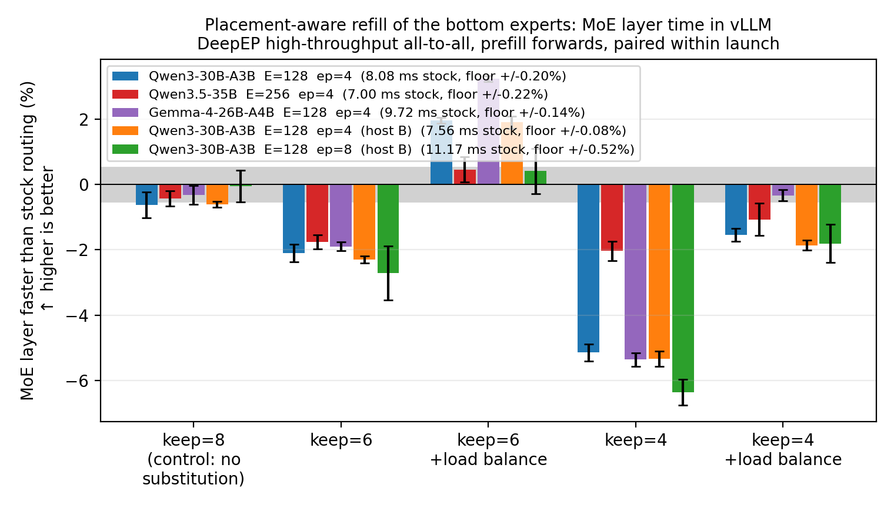

# Placement-Aware MoE Router

A vLLM 0.31 plugin. Keep the top `keep` experts the router picked, then refill the remaining `top_k - keep` slots from the experts living on GPUs those `keep` already force a visit to. Per-token GPU fan-out drops to `|ranks of the top keep|`; the number of experts per token, and so the expert GEMM work, is unchanged. The saving is pure all-to-all payload, which is why it has to be measured rather than counted. `PLACEMENT_LOAD_PENALTY` charges each substituted slot per expert slot already placed on its destination rank, flattening the load the plain rule piles onto the busiest rank without giving back any volume.

```bash
pip install --no-deps -e .   # registers the `vllm.general_plugins` entry point
PLACEMENT_KEEP=6 PLACEMENT_LOAD_PENALTY=1 vllm serve <model> -tp 4 --enable-expert-parallel
```

Unset `PLACEMENT_KEEP` and the plugin patches nothing - that is the arm every number below is divided by. `docker/` builds that image, `helm/` deploys it. The router passes the selection through with one warning wherever its premise fails (grouped top-k, score correction, EPLB replication, no renormalization, `ep_size` of 1 or above 32 - `_unsupported` in `plugin.py` is the whole list), because a rule that silently applied where it does not hold would measure as free and serve garbage.

The current nonzero load penalty shares rank counts across 16-token tiles.
The original layer tables below use the earlier per-token penalty at lambda=1;
the completed prefill and split-serving follow-ups use the tile penalty at lambda=8.
Teacher-forced scores under tile routing require the pseudo-likelihood qualification
described in the [result notes](results/2026-10-18/README.md).

## Code and experiment guide

- [`src/placement_router/`](src/placement_router/): installed vLLM plugin and production routing kernel.
- [`experiments/README.md`](experiments/README.md): benchmark, profiling and quality entry points.
- [`tests/`](tests/): CPU regression tests; run `python -m pytest` after `pip install -e '.[test]'`.
- [`reproduction/2026-10-18/`](reproduction/2026-10-18/): frozen prefill, split-serving, causal-scoring and stochastic-tail study sources.
- [`results/2026-10-18/`](results/2026-10-18/): audited result summaries and their interpretation.

The completed follow-up replicated a roughly 6–8% **prefill** throughput gain.
The matched split-serving experiment did **not** establish an end-to-end gain
when decode was included. See the [follow-up results](results/2026-10-18/README.md)
for workload definitions, quality results and uncertainty.

## What it measures out at

Timed inside a running `vllm serve` with CUDA events around DeepEP's dispatch and around `MoERunner._forward_impl`, prefill forwards at 16384 tokens per step, every arm divided by the base arms of *its own launch*. `keep=8` is the zero-substitution control, `x`n is how many independent launches a cell averages, and the floor is that row's own widest base-against-base spread, halved.


<!-- disptime -->
| model | stock ms / deepep dispatch ↓ | tokens / forward | floor | keep=8 (control: no substitution) ↑ | keep=6 ↑ | keep=6 +load balance ↑ | keep=4 ↑ | keep=4 +load balance ↑ |
|---|---|---|---|---|---|---|---|---|
| Qwen3-30B-A3B  E=128  ep=4 | 1.95 | 16384 | +/-0.36% | **+0.1%** x5 | **+0.7%** x5 | **+0.9%** x5 | **+3.8%** x4 | **+3.9%** x3 |
| Qwen3.5-35B  E=256  ep=4 | 1.93 | 16384 | +/-0.16% | **-0.0%** x3 | **-0.3%** x2 | **-0.2%** x3 | **+2.7%** x2 | **+2.6%** x3 |
| Gemma-4-26B-A4B  E=128  ep=4 | 2.15 | 16384 | +/-0.16% | **-0.0%** x2 | **+0.6%** x3 | **+0.6%** x2 | **+3.8%** x2 | **+3.6%** x3 |
| Qwen3-30B-A3B  E=128  ep=4  (host B) | 1.81 | 16384 | +/-0.05% | **+0.0%** x4 | **+1.0%** x4 | **+0.9%** x4 | **+4.1%** x4 | **+4.2%** x4 |
| Qwen3-30B-A3B  E=128  ep=8  (host B) | 2.23 | 16384 | +/-0.11% | **+0.0%** x7 | **+4.1%** x7 | **+4.0%** x9 | **+10.4%** x6 | **+10.4%** x6 |
<!-- /disptime -->

`keep=4` is faster on every row and every family, +2.6% to +10.4%, while the control is flat (-0.0% to +0.1%), so this is not the kernel's own cost. The last two rows are the same model on the same host type at two world sizes, so the `ep` step reads within-host: 0.9% becomes 4.0% at `keep=6` and 4.1% becomes 10.4% at `keep=4` - a wider world gives a fixed `keep` more distinct ranks to avoid visiting.

What reaches the whole layer is set by the *other* half of the collective. Combine returns each expert's output per token and is bound by the most loaded rank, so concentrating the bottom slots onto ranks a token already visits cuts total return bytes while raising that maximum (`runs/combtime.md`). The load-balance term targets exactly that rank:



<!-- moetime -->
| model | stock ms / moe layer ↓ | tokens / forward | floor | keep=8 (control: no substitution) ↑ | keep=6 ↑ | keep=6 +load balance ↑ | keep=4 ↑ | keep=4 +load balance ↑ |
|---|---|---|---|---|---|---|---|---|
| Qwen3-30B-A3B  E=128  ep=4 | 8.08 | 16384 | +/-0.20% | **-0.6%** x7 | **-2.1%** x7 | **+2.0%** x5 | **-5.1%** x6 | **-1.5%** x4 |
| Qwen3.5-35B  E=256  ep=4 | 7.00 | 16384 | +/-0.22% | **-0.4%** x5 | **-1.8%** x4 | **+0.5%** x3 | **-2.0%** x4 | **-1.1%** x3 |
| Gemma-4-26B-A4B  E=128  ep=4 | 9.72 | 16384 | +/-0.14% | **-0.3%** x3 | **-1.9%** x4 | **+3.2%** x2 | **-5.4%** x3 | **-0.3%** x3 |
| Qwen3-30B-A3B  E=128  ep=4  (host B) | 7.56 | 16384 | +/-0.08% | **-0.6%** x4 | **-2.3%** x4 | **+1.9%** x4 | **-5.3%** x4 | **-1.9%** x4 |
| Qwen3-30B-A3B  E=128  ep=8  (host B) | 11.17 | 16384 | +/-0.52% | **-0.1%** x8 | **-2.7%** x7 | **+0.4%** x10 | **-6.4%** x6 | **-1.8%** x7 |
<!-- /moetime -->

`keep=6 load_penalty=1` is the strongest whole-layer setting in this original matrix: positive on all five rows (+2.0%, +0.5%, +3.2%, +1.9%, +0.4%), clear of the floor on the four whose floor is under 0.25%, with the ep=8 row inside its own wider 0.52% floor - and `keep=6` costs +0.002 nats on paired NLL, 5-14x less than refilling the same slots at random (`experiments/accuracy.py`).

## Reproducing

```bash
experiments/k8s/launch.sh NAME=q30 TAG=q30pf MODEL=/models/bf16 DP=4 \
  A2A=deepep_high_throughput ARMS=base,base2,8,6,6p1,4,4p1,base3
for ph in moe disp comb; do PHASE=$ph PYTHONPATH=experiments python experiments/moeplot.py; done
PYTHONPATH=experiments python experiments/lbgain.py   # the load term against the plain rule, same launch
python3 -I experiments/readme_tables.py
```

`kernel.py` is the rule - Triton kernel, torch reference, fan-out metric, self-check - and `plugin.py` the hook. `moetime.py` are the in-engine timers, `moeplot.py` pairs them within launch against the measured floor, `imbalance.py` reads fan-out and per-rank load off the real router per `(ep, keep, load_penalty)` arm, `lbgain.py` the load term's own gain, `accuracy.py` the paired NLL cost. Prior art for substituting the bottom of the selection, and for the restricted-set reroute: arXiv 2412.00099, 2504.01337, 2505.13345; that the bottom of the selection is the uncertain part of it: arXiv 2602.02443.
